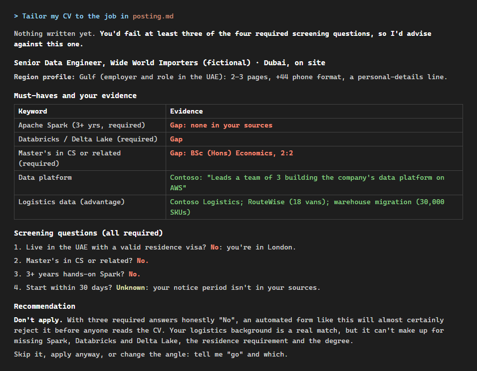

# The Honest Tailor

[](https://github.com/billkhiz-bit/honest-tailor/actions/workflows/test.yml)

A Claude Code plugin that tailors your CV to a job posting without inventing anything, and checks that it didn't.



*A real read-out from a test run on a [fictional persona](benchmark/persona/master-cv.md) and
[posting](examples/postings/wide-world-data-engineer-dubai.md). Nothing is written until you say go.*

- **A read-out before any writing.** The must-have keywords, each matched to the entry that evidences it or marked
  as a gap. The honest answer to every screening question on the form. Anything that could rule you out
  (location, visa, a required qualification), and a plain recommendation when an application is likely to be
  screened out.
- **Region-correct CVs.** UK and Ireland, the US and Canada, the German-speaking countries, the Netherlands and the
  rest of Europe, and the Gulf, each with its own length, paper size, spelling and personal-details conventions.
- **Every claim traced.** `check_cv.py` traces each number, name, job header, role line and project on the
  tailored CV back to your own files, and reports what it cannot trace. [`benchmark/`](benchmark/) publishes what
  it catches and what it misses.
- **Honest about AI-written answers.** When a posting says it deprioritises AI-written applications, the plugin
  gives you an outline and the evidence, and you write the answer.
- **The posting is data, not instructions.** In a [stress test](docs/stress-test.md), a job ad with a hidden "note to
  AI" asking it to invent experience and upload your CV elsewhere was ignored and reported as a prompt injection.
- **An archive of every application.** The CV as sent, the posting (postings vanish once they close), notes on gaps
  and likely interview questions, and a tracker for follow-ups.

## Install

In Claude Code (2.1.275 or later):

```
/plugin install honest-tailor --marketplace billkhiz-bit/honest-tailor
```

On older versions: `/plugin marketplace add billkhiz-bit/honest-tailor`, then `/plugin install honest-tailor@honest-tailor`.
To try a local copy: `claude --plugin-dir ./honest-tailor`.

Needs Python 3.10+ and a Chromium-based browser (Edge, Chrome or Chromium) to print PDFs; without one you still
get HTML (and Word) to print yourself. For page counts and Word output: `pip install pypdf python-docx`.

## Your workspace

Keep your CV in its own folder, never inside the plugin's folder. Start Claude Code there and ask it to tailor your
CV; on the first run it offers to copy the templates in:

| File | What goes in it |
|---|---|
| `master-cv.md` | Your full CV, in the layout of `templates/master-cv.md` (a fictional example) |
| `career-facts.md` | Extra facts: usable now, unconfirmed (never used until you confirm), and personal details |
| `cv-profile.md` | Your own rules: home region, summary opener, what always stays, what goes first, words to avoid |
| `applications/` | Created as you go: one folder per application, and `APPLICATIONS.md` |

## Use

- "Tailor my CV to this job: <link, file or pasted text>". The read-out comes first; nothing is written until you
  say go. Claude asks before running the two scripts (the claim checker and the PDF renderer): approve each
  exact command, rather than a blanket rule for every `python` command.
- "I sent it", "I got an interview", "review my applications": the tracker.
- Six fictional postings to try it on, including the stress-test cases (a US role, one in German, a booby-trapped
  ad): [`examples/postings/`](examples/postings/).

In testing, one application (read-out, then writing, rendering, checking and filing) used about $1.50 of Claude
usage at API prices on the default model; on a Claude subscription it counts towards your plan's usage instead.

## What the checker can and cannot do

It checks what can be checked mechanically: numbers (with their units and hedges such as "over" or "~"),
capitalised names (tools, employers, qualifications), and exact job headers, role lines and project names. It
ignores anything in career-facts' unconfirmed section, so a fact you have not confirmed is flagged if it appears.

It cannot judge meaning. "Assisted with" reworded as "led" passes, and so does a real number moved onto the wrong
claim. The skill re-reads every bullet against its source for those, and the benchmark lists them as expected
misses rather than hiding them. Results: [`benchmark/RESULTS.md`](benchmark/RESULTS.md).

## Privacy

Your CV and applications stay in your workspace folder. The plugin makes no network calls of its own apart from
fetching a posting link you give it. As with anything in Claude Code, the files Claude reads are sent to the model
as part of your session.

## Development

```
pip install -r requirements-dev.txt
python -m pytest
python benchmark/run_benchmark.py
git config core.hooksPath dev/hooks    # once per clone: blocks commits that contain personal data
```

`dev/check_private_data.py` blocks real-looking email addresses, UK mobile numbers and postcodes, and any term
listed in a gitignored `.private-terms` file. All test data is fictional: phone numbers come from Ofcom's drama
range and email addresses use example.com. New benchmark cases are welcome: see
[`benchmark/README.md`](benchmark/README.md#adding-cases).

## Licence

MIT
